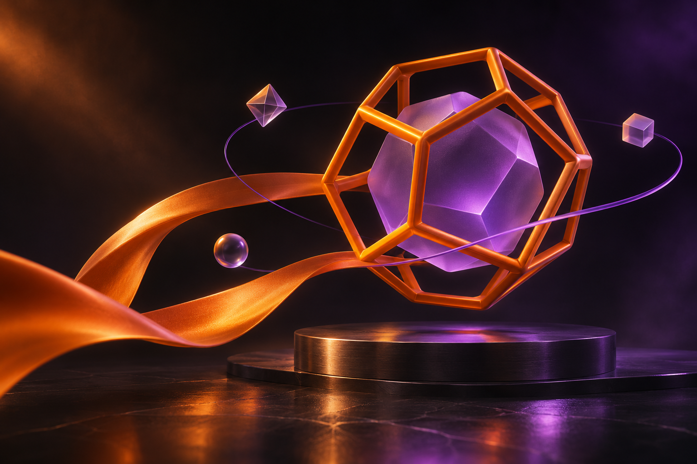
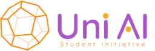

<p align="center">
  <picture>
    <source media="(prefers-color-scheme: dark)" srcset="https://raw.githubusercontent.com/UniAI-Student-Intiative/.github/main/profile/assets/banner-dark.svg">
    
  </picture>
</p>

<p align="center">
  
</p>

<p align="center">
  <a href="https://uniai.gr/"></a>
  <a href="#join-and-contribute"></a>
  <a href="https://www.linkedin.com/company/uniai/"></a>
  <a href="https://www.instagram.com/uniai.gr/"></a>
  <a href="#join-and-contribute"></a>
  
</p>

<p align="center">
  <a href="#mission-and-identity">Our mission</a> ·
  <a href="#the-ecosystem">The ecosystem</a> ·
  <a href="#join-and-contribute">Build with us</a> ·
  <a href="#join-and-contribute">Join the community</a>
</p>

## Mission and identity

**University AI Student Organization. A place to learn together and build something that matters.**

UniAI is a student-led AI initiative in Greece, connecting academic research, practical AI engineering and community innovation. We bring students from different universities and disciplines into a shared space for experiments, hands-on learning and collaboration with researchers and industry.

Curiosity is the starting point. Reproducible work, useful tools and knowledge shared with the next student are how we turn it into progress.

<p align="center"></p>
<p align="center"><sub>Different perspectives. Connected by curiosity.</sub></p>

<picture>
  <source media="(prefers-color-scheme: dark)" srcset="https://raw.githubusercontent.com/UniAI-Student-Intiative/.github/main/profile/assets/wave-dark.svg">
  
</picture>

## The ecosystem

### Five departments. One shared orbit.

<picture>
  <source media="(prefers-color-scheme: dark)" srcset="https://raw.githubusercontent.com/UniAI-Student-Intiative/.github/main/profile/assets/ecosystem-dark.svg">
  
</picture>


<table align="center" width="100%">
  <tr>
    <td width="50%" valign="top">
      <h3>01 / Open-Source AI &amp; Research Labs</h3>
      <p>Read papers, reproduce results and turn questions into inspectable experiments. Build models, evaluations and tools that another student can run.</p>
      <p><strong>Focus:</strong> reproducibility, applied ML, responsible experimentation.</p>
    </td>
    <td width="50%" valign="top">
      <h3>02 / Technical Workshops &amp; Bootcamps</h3>
      <p>Learn by making. Connect fundamentals to working projects through practical sessions, peer support and technical walkthroughs.</p>
      <p><strong>Focus:</strong> Python, model development, AI applications.</p>
    </td>
  </tr>
  <tr>
    <td valign="top">
      <h3>03 / Hackathons &amp; Competitions</h3>
      <p>Work across disciplines on real challenges, with space for prototyping, mentorship, evaluation and a clear explanation of what the team built.</p>
      <p><strong>Focus:</strong> team formation, Makeathon-style challenges, demonstrations.</p>
    </td>
    <td valign="top">
      <h3>04 / IT Infrastructure &amp; Platform Engineering</h3>
      <p>Build the foundations that keep the community running: event experiences, participant workflows, developer tooling and maintainable infrastructure.</p>
      <p><strong>Focus:</strong> UniAI Events, access controls, reliable delivery.</p>
    </td>
  </tr>
  <tr>
    <td colspan="2" valign="top">
      <h3>05 / Community, PR &amp; Partnerships</h3>
      <p>Connect students, researchers and partners. Make technical work accessible through communication, welcoming onboarding and opportunities to share knowledge.</p>
      <p><strong>Focus:</strong> community programmes, storytelling, university and industry connections.</p>
    </td>
  </tr>
</table>

### Inside the lab

```text
  student@uniai:~$ explore --together
  |
  +-- research/       ask -> test -> reproduce
  +-- workshops/      learn -> practise -> teach
  +-- hackathons/     connect -> build -> demonstrate
  +-- infrastructure/ design -> ship -> maintain
  `-- community/      welcome -> collaborate -> grow

  > next contribution: yours_
```

### Technical tracks and toolkit

AI and tooling tracks are proposed learning and contribution areas for 2026–2027. They span research projects, practical workshops and the platforms supporting our community.

<table align="center" width="100%">
  <tr>
    <th align="left">AI &amp; research track</th>
    <th align="left">Platform track</th>
    <th align="left">Engineering practices</th>
  </tr>
  <tr>
    <td valign="top"><strong>Python · PyTorch</strong><br>Experiments, notebooks, model training and evaluation.<br><br><em>Proposed ecosystem track.</em></td>
    <td valign="top"><strong>TypeScript · React · Tailwind</strong><br>Participant experiences and staff workflows in UniAI Events.<br><br><em>UniAI Events platform stack.</em></td>
    <td valign="top"><strong>MCP · Docker · Git</strong><br>MCP for proposed tool integrations; Docker for reproducible environments; Git for collaboration.<br><br><em>MCP is a proposed learning area.</em></td>
  </tr>
</table>

<p align="center">
  
  
  
  
  
  
  
  
</p>

<p align="center"></p>

## Season board

### 2026–2027 / From first question to shared work

<picture>
  <source media="(prefers-color-scheme: dark)" srcset="https://raw.githubusercontent.com/UniAI-Student-Intiative/.github/main/profile/assets/lab-board-dark.svg">
  
</picture>

<details>
<summary><strong>2026–2027 Roadmap &amp; Flagship Events</strong></summary>

This is a proposed organisation-level agenda for the 2026–2027 season. Dates, owners, venues and registration links require confirmation by the UniAI team.

| Initiative | Proposed outcome |
| --- | --- |
| Student onboarding | A clear membership route, introduction to the pillars and a first contribution with peer support |
| Open-source repositories | Reproducible project templates, documented experiments and contribution guidance |
| AI & research track | Python and PyTorch learning projects with explicit evaluation and reproducibility notes |
| AI applications track | Useful applications and an introduction to MCP-based tool integration |
| Platform engineering track | Improvements to event workflows, documentation and operational reliability |
| Workshops & bootcamps | Practical sessions with material students can revisit |
| Hackathons & showcases | Team challenges, mentorship, demonstrations and student project sharing |

**Flagship reference:** the [official UniAI website](https://uniai.gr/en) records Makeathon 2026 on 15–17 May 2026, alongside earlier RoboAI Lab and Students 4 Students events. Those past programmes inform this direction; they are not announcements for 2027.

</details>

<picture>
  <source media="(prefers-color-scheme: dark)" srcset="https://raw.githubusercontent.com/UniAI-Student-Intiative/.github/main/profile/assets/galaxy-dark.svg">
  
</picture>

## Join and contribute

**Bring a question, a skill or an idea. We will work on the next step together.**

<details>
<summary><strong>How to Join &amp; Contribute: Student &amp; Developer Onboarding</strong></summary>

### Join the student community

1. Visit the [official UniAI website](https://uniai.gr/) and use its current membership route.
2. Tell the team what you want to learn, build or help organise. Technical and non-technical contributions both matter.
3. Choose an area with the organisers, then start with a small, clear task and someone to review it.

### Contribute as a developer

1. Choose a pillar and discuss a small first contribution with the team.
2. Ask the maintainers for the relevant repository, setup guidance and contribution process.
3. Work on a separate branch, document what you changed and include evidence that it works.
4. Share a focused pull request and use review as a chance to learn together.

Membership and repository access are coordinated by the organisers.

</details>

<details>
<summary><strong>Departments &amp; Communication Channels</strong></summary>

| Area | Start the conversation about |
| --- | --- |
| AI & research | Reading groups, reproducible experiments, research questions |
| Workshops & bootcamps | Learning goals, session material, peer mentoring |
| Hackathons & competitions | Teams, challenges, mentoring, event delivery |
| IT & platform engineering | Event tooling, maintainability, infrastructure |
| Community, PR & partnerships | Membership, communication, collaboration |

Use the [official website](https://uniai.gr/) for membership and the current community channels. Follow [LinkedIn](https://www.linkedin.com/company/uniai/) for professional updates and [Instagram](https://www.instagram.com/uniai.gr/) for community activity. Ask the organisers for the current community or Discord invitation.

Discuss technical contributions with the maintainers through the organisation. Share security concerns privately with the team and avoid posting secrets or personal data.

</details>


<p align="center"></p>

<p align="center"><a href="https://uniai.gr/"></a></p>

<p align="center"><strong>Built by students. Shared through curiosity.</strong><br>Learn with us. Build with us. Connect with UniAI.</p>
